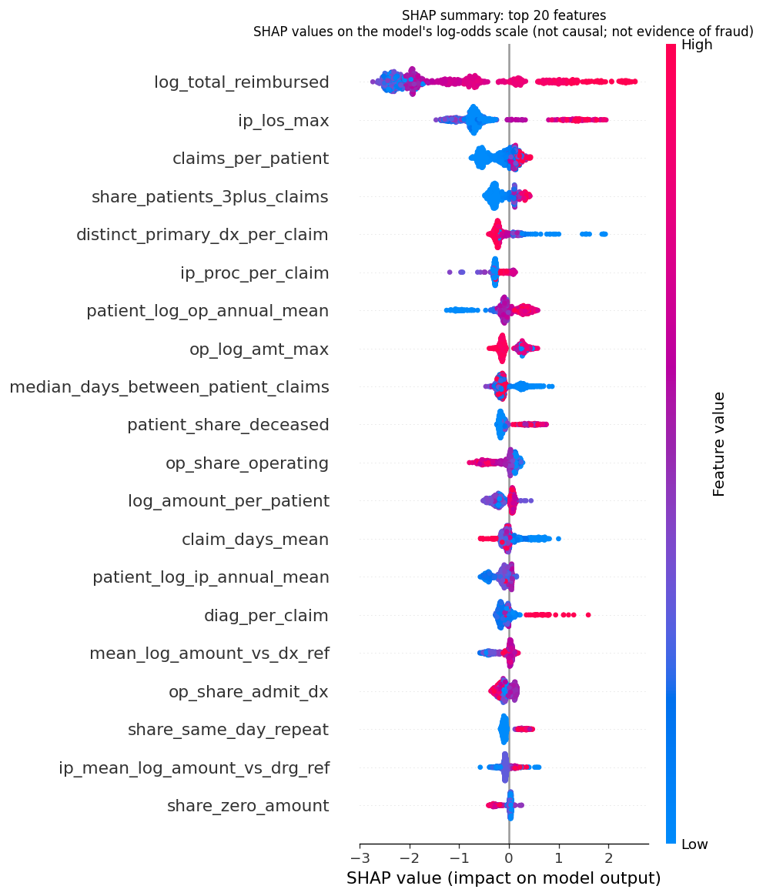
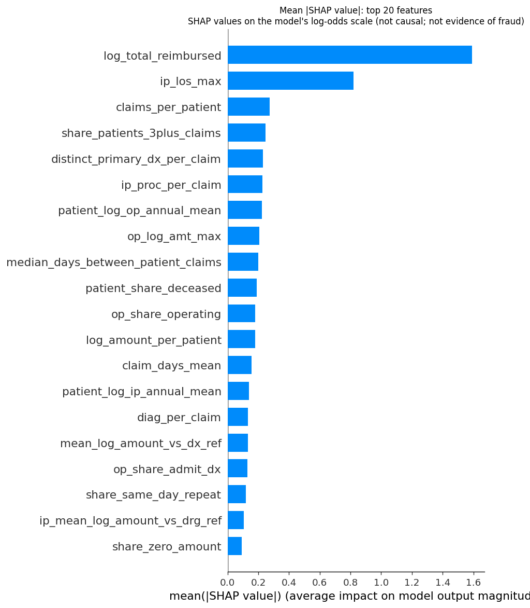
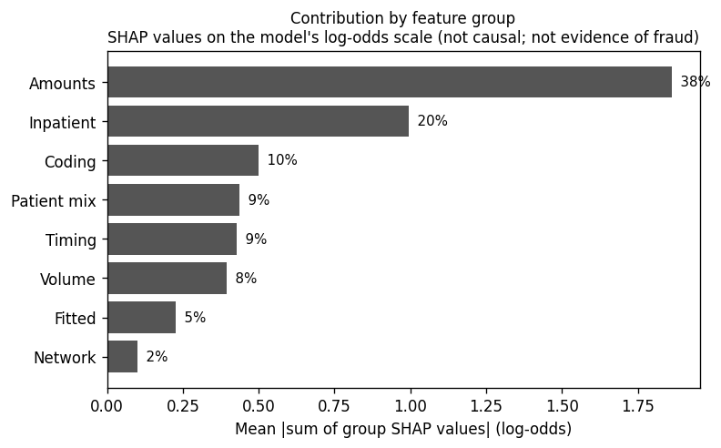
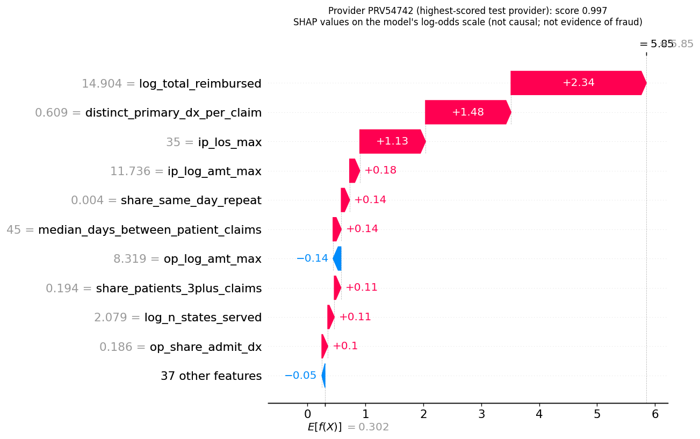
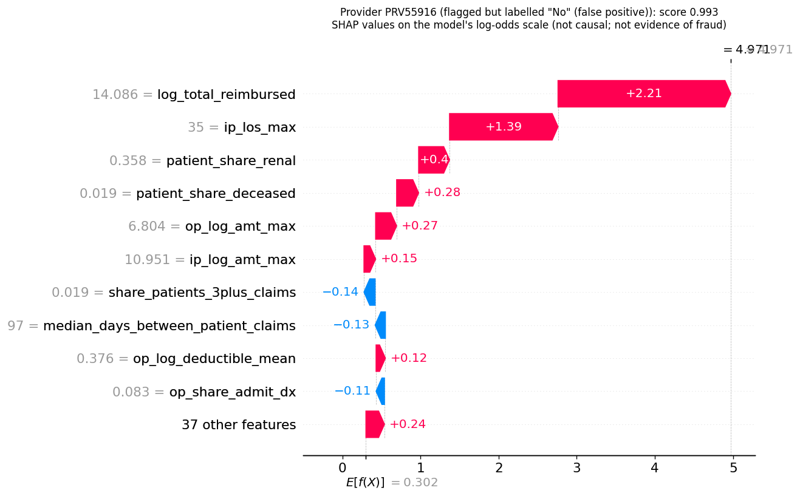
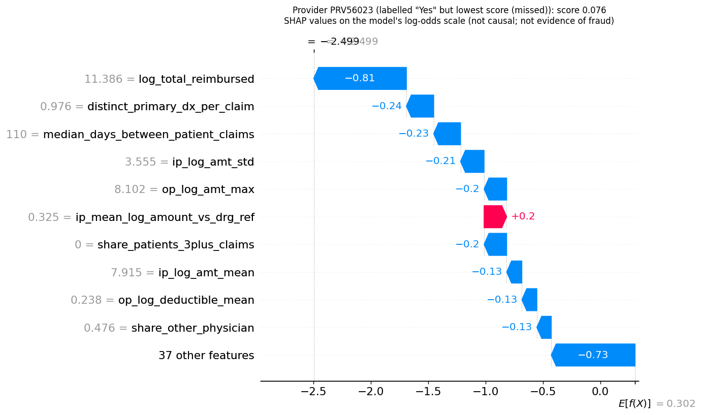

# Phase 3: SHAP explanations for the provider-level XGBoost model

_Generated 2026-11-11T10:39:09+00:00 by `training/explain_shap.py` for run `run-20261111-102008` (SHAP 0.46.0, XGBoost 2.1.3). The model was not retrained (SHA-256 `24939f046aa1b073…`, unchanged: True)._

> **How to read these explanations**
> - They explain the **provider-level risk score** of the Phase 2 XGBoost model only. They do not apply to individual claims or to the Isolation Forest.
> - A SHAP value shows how much a feature moved **this model's** output for a provider. It is **not a causal effect** and **not evidence of fraud**.
> - The model reproduces the dataset's `PotentialFraud` provider labels, whose provenance is **undocumented**.

## 1. Scale, base value and interpretation

- **Explainer:** shap.TreeExplainer (tree_path_dependent, exact). No background sample is needed, and results are deterministic.
- **Output scale:** the model's raw output, **log-odds**. For each provider: `log-odds = base value + Σ SHAP values`, and `risk score = sigmoid(log-odds)` (the same as `predict_proba`).
- **Base value:** +0.3023 log-odds, i.e. a score of 0.575. This is the model's average output over its training data (tree cover).
- **Why the base score is 0.58 although about 9% of providers are labelled "Yes":** the model was trained with class weighting (`scale_pos_weight`), which shifts its output upward. **The risk score is a ranking score, not a calibrated probability.** The decision threshold (0.643) was chosen on development out-of-fold predictions (Phase 2).
- A positive SHAP value raises the score above the base; a negative value lowers it. Values add up exactly, so contributions can be compared in log-odds.

## 2. Consistency checks (all labelled providers)

| Check | Result |
|---|---|
| Providers checked | 5,410 |
| Feature order matches the model's input features | True |
| max \|base + Σ SHAP − model log-odds\| | 6.7e-06 |
| max \|sigmoid(base + Σ SHAP) − predict_proba\| | 6.6e-07 |
| max \|SHAP − XGBoost's built-in exact contributions\| | 0.0e+00 |
| max \|score − Phase 2 inference score (`fraud_ml/predict.py`)\| | 0.0e+00 |
| Identical values from two independent explainer instances | True |
| Saved model file unchanged | True |

## 3. Global feature importance (held-out test providers)





Mean |SHAP| = average size of a feature's effect on the log-odds. *Direction* comes from the correlation between the feature's value and its SHAP value across providers. This describes the model's learned pattern, not a causal relationship.

| Rank | Feature | Group | Mean \|SHAP\| | Share | Direction | What it measures |
|---|---|---|---|---|---|---|
| 1 | `log_total_reimbursed` | Amounts | 1.591 | 23.0% | higher values raise the score | log1p(sum of amounts) |
| 2 | `ip_los_max` | Inpatient | 0.821 | 11.8% | higher values raise the score | max length of stay; 0 if none |
| 3 | `claims_per_patient` | Volume | 0.275 | 4.0% | higher values raise the score | claims / distinct patients |
| 4 | `share_patients_3plus_claims` | Timing | 0.247 | 3.6% | higher values raise the score | patients with >=3 claims at this provider / patients |
| 5 | `distinct_primary_dx_per_claim` | Coding | 0.229 | 3.3% | higher values lower the score | distinct primary diagnoses / claims |
| 6 | `ip_proc_per_claim` | Inpatient | 0.228 | 3.3% | higher values raise the score | mean number of procedure codes on inpatient claims |
| 7 | `patient_log_op_annual_mean` | Patient mix | 0.223 | 3.2% | higher values raise the score | mean log1p(annual outpatient total, clipped) |
| 8 | `op_log_amt_max` | Amounts | 0.206 | 3.0% | higher values lower the score | max log1p(amount); 0 if none |
| 9 | `median_days_between_patient_claims` | Timing | 0.199 | 2.9% | higher values lower the score | median gap between consecutive claims of the same patient at this provider; 400 if no repeats |
| 10 | `patient_share_deceased` | Patient mix | 0.189 | 2.7% | higher values raise the score | share of patients with a date of death in the period |
| 11 | `op_share_operating` | Coding | 0.181 | 2.6% | higher values lower the score | outpatient claims with an operating physician / outpatient claims |
| 12 | `log_amount_per_patient` | Amounts | 0.180 | 2.6% | higher values raise the score | log1p(sum of amounts / distinct patients) |
| 13 | `claim_days_mean` | Timing | 0.155 | 2.2% | higher values lower the score | mean claim duration (days) |
| 14 | `patient_log_ip_annual_mean` | Patient mix | 0.140 | 2.0% | higher values raise the score | mean log1p(annual inpatient total, negatives clipped to 0) |
| 15 | `diag_per_claim` | Coding | 0.133 | 1.9% | higher values raise the score | mean number of diagnosis codes per claim |

The remaining 32 features account for 27.9% of total mean |SHAP|. The full table is in `shap_explanations.json`.

**Concentration:** the top 3 features account for 39% of total mean |SHAP|, and the top 10 for 61%.

**Stability:** the ranking computed on development providers agrees with the test-provider ranking (Spearman ρ = 0.998; 9/10 of the top-10 features shared).

## 4. Contribution by feature group



Group contribution = the absolute value of the **sum** of a group's SHAP values for each provider (valid because SHAP values add up), averaged over test providers. A group whose features push in opposite directions can therefore show a smaller total than its individual features suggest.

| Group | Features | Mean \|group SHAP\| | Share | Mean signed group SHAP |
|---|---|---|---|---|
| Amounts | 12 | 1.861 | 37.7% | -1.437 |
| Inpatient | 5 | 0.995 | 20.1% | -0.700 |
| Coding | 5 | 0.501 | 10.1% | -0.352 |
| Patient mix | 7 | 0.436 | 8.8% | -0.316 |
| Timing | 5 | 0.428 | 8.7% | -0.189 |
| Volume | 8 | 0.395 | 8.0% | -0.329 |
| Fitted | 3 | 0.225 | 4.6% | -0.177 |
| Network | 2 | 0.099 | 2.0% | -0.067 |

Feature groups follow `docs/FEATURES.md`. "Fitted" = training-reference features (code rarity, amount vs typical for the diagnosis/DRG). This grouping is finer than the Phase 2 ablation groups. Ablation measures performance lost when a group is removed; SHAP measures how much the trained model's output moves. The two answer different questions and need not rank groups identically.

## 5. Individual provider explanations (illustrative examples)

Examples were chosen by a fixed rule from the held-out test providers: the highest-scored provider, the highest-scored flagged provider labelled "No", and the lowest-scored provider labelled "Yes". They illustrate the output and are not a sample of typical cases. Explanations are generated from the model's actual prediction and SHAP values.

### PRV54742: highest-scored test provider

Dataset label: **Yes** · risk score **0.997** · threshold 0.643 · flagged

| # | Feature | Value | Above this share of development providers | SHAP (log-odds) | Effect |
|---|---|---|---|---|---|
| 1 | `log_total_reimbursed` | 14.9 | 100% | +2.335 | increases risk score |
| 2 | `distinct_primary_dx_per_claim` | 0.6089 | 0% | +1.477 | increases risk score |
| 3 | `ip_los_max` | 35 | 95% | +1.134 | increases risk score |
| 4 | `ip_log_amt_max` | 11.74 | 100% | +0.176 | increases risk score |
| 5 | `share_same_day_repeat` | 0.004228 | 90% | +0.144 | increases risk score |
| 6 | `median_days_between_patient_claims` | 45 | 15% | +0.142 | increases risk score |
| 7 | `op_log_amt_max` | 8.319 | 94% | -0.135 | decreases risk score |
| 8 | `share_patients_3plus_claims` | 0.1941 | 86% | +0.114 | increases risk score |
| 9 | `log_n_states_served` | 2.079 | 93% | +0.113 | increases risk score |
| 10 | `op_share_admit_dx` | 0.186 | 46% | +0.102 | increases risk score |
| | *all other features* | | | -0.053 | |



Generated explanation:

```text
Provider PRV54742: model risk score 0.997 (at or above the decision threshold 0.643, so flagged for review).
The model starts from a baseline of +0.302 log-odds (score 0.575) and the provider's features move it to +5.850 log-odds.
Features that raised the score most:
  - log_total_reimbursed = 14.9 (above 100% of development providers; log1p(sum of amounts)): +2.335 log-odds
  - distinct_primary_dx_per_claim = 0.6089 (above 0% of development providers; distinct primary diagnoses / claims): +1.477 log-odds
  - ip_los_max = 35 (above 95% of development providers; max length of stay; 0 if none): +1.134 log-odds
  - ip_log_amt_max = 11.74 (above 100% of development providers; max log1p(amount); 0 if none): +0.176 log-odds
  - share_same_day_repeat = 0.004228 (above 90% of development providers; claims where the same patient has another claim at this provider starting the same day / claims): +0.144 log-odds
  - median_days_between_patient_claims = 45 (above 15% of development providers; median gap between consecutive claims of the same patient at this provider; 400 if no repeats): +0.142 log-odds
  - share_patients_3plus_claims = 0.1941 (above 86% of development providers; patients with >=3 claims at this provider / patients): +0.114 log-odds
  - log_n_states_served = 2.079 (above 93% of development providers; log1p(distinct patient states)): +0.113 log-odds
  - op_share_admit_dx = 0.186 (above 46% of development providers; outpatient claims with an admit diagnosis / outpatient claims): +0.102 log-odds
Features that lowered the score most:
  - op_log_amt_max = 8.319 (above 94% of development providers; max log1p(amount); 0 if none): -0.135 log-odds
All other features together: -0.053 log-odds.
Note: SHAP values show how this model arrived at its score for this provider. They are not causal effects and not evidence of fraud. The model reproduces the dataset's provider-level PotentialFraud labels, whose provenance is undocumented, and its score is a class-weighted ranking score, not a calibrated probability.
```

### PRV55916: flagged but labelled "No" (false positive)

Dataset label: **No** · risk score **0.993** · threshold 0.643 · flagged

| # | Feature | Value | Above this share of development providers | SHAP (log-odds) | Effect |
|---|---|---|---|---|---|
| 1 | `log_total_reimbursed` | 14.09 | 99% | +2.211 | increases risk score |
| 2 | `ip_los_max` | 35 | 95% | +1.388 | increases risk score |
| 3 | `patient_share_renal` | 0.3585 | 94% | +0.396 | increases risk score |
| 4 | `patient_share_deceased` | 0.01887 | 89% | +0.281 | increases risk score |
| 5 | `op_log_amt_max` | 6.804 | 28% | +0.269 | increases risk score |
| 6 | `ip_log_amt_max` | 10.95 | 93% | +0.150 | increases risk score |
| 7 | `share_patients_3plus_claims` | 0.01887 | 60% | -0.143 | decreases risk score |
| 8 | `median_days_between_patient_claims` | 97 | 49% | -0.132 | decreases risk score |
| 9 | `op_log_deductible_mean` | 0.3759 | 92% | +0.119 | increases risk score |
| 10 | `op_share_admit_dx` | 0.08333 | 19% | -0.107 | decreases risk score |
| | *all other features* | | | +0.237 | |



Generated explanation:

```text
Provider PRV55916: model risk score 0.993 (at or above the decision threshold 0.643, so flagged for review).
The model starts from a baseline of +0.302 log-odds (score 0.575) and the provider's features move it to +4.971 log-odds.
Features that raised the score most:
  - log_total_reimbursed = 14.09 (above 99% of development providers; log1p(sum of amounts)): +2.211 log-odds
  - ip_los_max = 35 (above 95% of development providers; max length of stay; 0 if none): +1.388 log-odds
  - patient_share_renal = 0.3585 (above 94% of development providers; share of distinct patients with renal disease): +0.396 log-odds
  - patient_share_deceased = 0.01887 (above 89% of development providers; share of patients with a date of death in the period): +0.281 log-odds
  - op_log_amt_max = 6.804 (above 28% of development providers; max log1p(amount); 0 if none): +0.269 log-odds
  - ip_log_amt_max = 10.95 (above 93% of development providers; max log1p(amount); 0 if none): +0.150 log-odds
  - op_log_deductible_mean = 0.3759 (above 92% of development providers; mean log1p(deductible); 0 if none): +0.119 log-odds
Features that lowered the score most:
  - share_patients_3plus_claims = 0.01887 (above 60% of development providers; patients with >=3 claims at this provider / patients): -0.143 log-odds
  - median_days_between_patient_claims = 97 (above 49% of development providers; median gap between consecutive claims of the same patient at this provider; 400 if no repeats): -0.132 log-odds
  - op_share_admit_dx = 0.08333 (above 19% of development providers; outpatient claims with an admit diagnosis / outpatient claims): -0.107 log-odds
All other features together: +0.237 log-odds.
Note: SHAP values show how this model arrived at its score for this provider. They are not causal effects and not evidence of fraud. The model reproduces the dataset's provider-level PotentialFraud labels, whose provenance is undocumented, and its score is a class-weighted ranking score, not a calibrated probability.
```

### PRV56023: labelled "Yes" but lowest score (missed)

Dataset label: **Yes** · risk score **0.076** · threshold 0.643 · not flagged

| # | Feature | Value | Above this share of development providers | SHAP (log-odds) | Effect |
|---|---|---|---|---|---|
| 1 | `log_total_reimbursed` | 11.39 | 75% | -0.808 | decreases risk score |
| 2 | `distinct_primary_dx_per_claim` | 0.9762 | 54% | -0.238 | decreases risk score |
| 3 | `median_days_between_patient_claims` | 110 | 54% | -0.234 | decreases risk score |
| 4 | `ip_log_amt_std` | 3.555 | 98% | -0.205 | decreases risk score |
| 5 | `op_log_amt_max` | 8.102 | 64% | -0.197 | decreases risk score |
| 6 | `ip_mean_log_amount_vs_drg_ref` | 0.3254 | 94% | +0.197 | increases risk score |
| 7 | `share_patients_3plus_claims` | 0 | 0% | -0.197 | decreases risk score |
| 8 | `ip_log_amt_mean` | 7.915 | 64% | -0.132 | decreases risk score |
| 9 | `op_log_deductible_mean` | 0.2379 | 80% | -0.130 | decreases risk score |
| 10 | `share_other_physician` | 0.4762 | 84% | -0.126 | decreases risk score |
| | *all other features* | | | -0.730 | |



Generated explanation:

```text
Provider PRV56023: model risk score 0.076 (below the decision threshold 0.643, so not flagged).
The model starts from a baseline of +0.302 log-odds (score 0.575) and the provider's features move it to -2.499 log-odds.
Features that raised the score most:
  - ip_mean_log_amount_vs_drg_ref = 0.3254 (above 94% of development providers; mean over paid inpatient claims of log1p(amount) - log1p(training median for the same DRG); 0 if none): +0.197 log-odds
Features that lowered the score most:
  - log_total_reimbursed = 11.39 (above 75% of development providers; log1p(sum of amounts)): -0.808 log-odds
  - distinct_primary_dx_per_claim = 0.9762 (above 54% of development providers; distinct primary diagnoses / claims): -0.238 log-odds
  - median_days_between_patient_claims = 110 (above 54% of development providers; median gap between consecutive claims of the same patient at this provider; 400 if no repeats): -0.234 log-odds
  - ip_log_amt_std = 3.555 (above 98% of development providers; std of log1p(amount); 0 if <2 claims): -0.205 log-odds
  - op_log_amt_max = 8.102 (above 64% of development providers; max log1p(amount); 0 if none): -0.197 log-odds
  - share_patients_3plus_claims = 0 (above 0% of development providers; patients with >=3 claims at this provider / patients): -0.197 log-odds
  - ip_log_amt_mean = 7.915 (above 64% of development providers; mean log1p(amount); 0 if no inpatient claims): -0.132 log-odds
  - op_log_deductible_mean = 0.2379 (above 80% of development providers; mean log1p(deductible); 0 if none): -0.130 log-odds
  - share_other_physician = 0.4762 (above 84% of development providers; claims with an other physician / claims): -0.126 log-odds
All other features together: -0.730 log-odds.
Note: SHAP values show how this model arrived at its score for this provider. They are not causal effects and not evidence of fraud. The model reproduces the dataset's provider-level PotentialFraud labels, whose provenance is undocumented, and its score is a class-weighted ranking score, not a calibrated probability.
```

## 6. Limitations

- SHAP explains the model, not the world. A feature with a large SHAP value is one the model relies on, not one that causes fraud.
- Correlated features (e.g. inpatient-related features, claim-volume features) can share or swap credit. Interpret individual feature values within their group.
- Tree-path-dependent SHAP follows the model's training-data structure. Values for unusual providers are less certain.
- Scores are class-weighted ranking scores, not calibrated probabilities.
- Explanations inherit every Phase 2 limitation: provider-level labels of undocumented provenance, a strong link with provider size and inpatient mix, 2008–09 ICD-9 era data, and dataset-specific features the application database does not have.
- Explanations cover provider-level scores only. The claim-level Isolation Forest is separate and not explained here.

## 7. Reproduce

```bash
.venv/Scripts/python.exe training/explain_shap.py                          # this report and all figures
.venv/Scripts/python.exe scripts/explain_provider.py --provider PRV51001 --top 10   # one provider
```